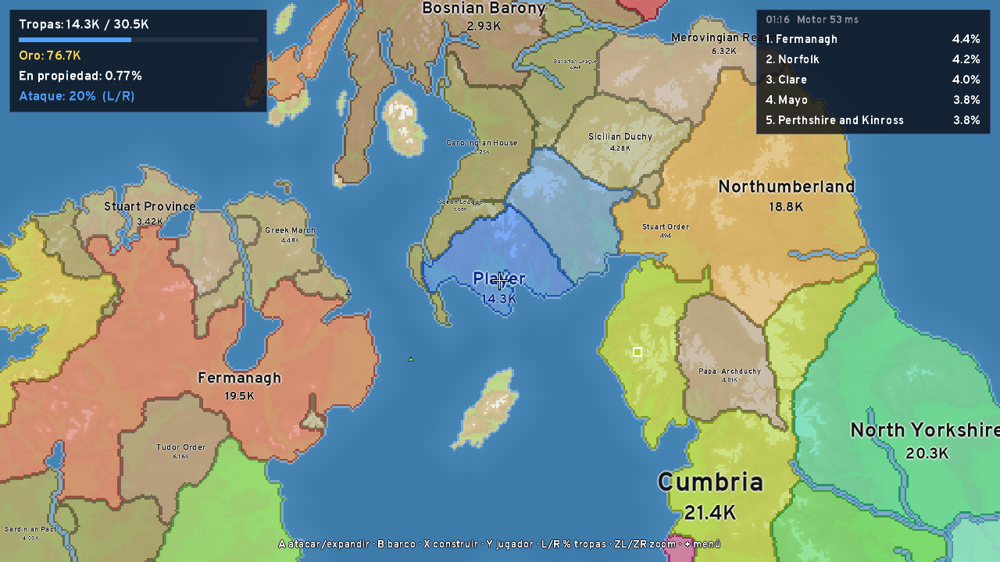

# OpenFront para Nintendo Switch

Port homebrew no oficial de [OpenFront](https://github.com/openfrontio/OpenFrontIO),
el juego de estrategia territorial en tiempo real, para Nintendo Switch.

No es una versión web empaquetada: el **motor real de OpenFront** (la simulación
determinista en TypeScript, sin cambios) se ejecuta dentro de
[QuickJS-ng](https://github.com/quickjs-ng/quickjs) en una aplicación nativa
hecha con libnx y SDL2, con renderizado, interfaz y controles propios para la
consola.



## Qué incluye

- Partidas para un jugador contra **naciones** (IA) y **tribus** (bots), con
  la misma lógica de juego que openfront.io: expansión, ataques, barcos de
  transporte, alianzas, embargos, construcciones (ciudad, puerto, puesto de
  defensa, fábrica, silo, SAM, barco de guerra) y bombas nucleares.
- Los **135 mapas** de OpenFront (en tamaño "compacto").
- Idioma automático según la consola, con las traducciones de OpenFront
  (español, inglés y 40 más).
- Controles con Joy-Con / Pro Controller y **pantalla táctil**.
- Teclado del sistema para elegir tu nombre (por defecto, el de tu perfil).

## Qué no incluye (todavía)

- **Multijugador online.** Necesitaría el protocolo de los servidores de
  OpenFront (con su autenticación y antibots) y que la consola simule a la
  velocidad exacta del servidor; la Switch probablemente no llega (ver
  *Rendimiento*).
- Sonido, cosméticos/skins, ferrocarriles dibujados, equipos, repeticiones y
  partidas guardadas.

## Estado y rendimiento

Probado: compilación del `.nro` con devkitA64, la versión de escritorio del
mismo código (menús, partida completa, menús de construcción y de jugador) y
los 135 mapas cargando y simulando. **No se ha probado en una Switch real.**

QuickJS es un intérprete (sin JIT), así que el motor va más lento que en un
navegador. En un Xeon a 2,8 GHz cada tick tarda ~50–65 ms con Britania y
40–100 tribus (el juego web avanza 10 ticks por segundo, 100 ms por tick). La
app activa el modo *boost* de CPU de la Switch (1785 MHz), pero aun así se
espera que cada tick tarde entre 2 y 3 veces más. Cuando la simulación no llega,
la partida avanza más despacio en lugar de dar tirones: el dibujado va en otro
hilo. El HUD muestra lo que tarda cada tick («Motor … ms»). Para que vaya más
fluido: mapas pequeños (Oceanía, Hawái, Islas Feroe, Japón…) y menos tribus.

## Controles

| Botón | Acción |
| --- | --- |
| Stick izquierdo | Mover el cursor (en el borde, desplaza el mapa) |
| Stick derecho | Desplazar el mapa |
| ZL / ZR | Alejar / acercar |
| A | Elegir inicio · atacar o expandirte hacia la casilla (como el clic izquierdo) |
| B | Enviar barco de transporte a la casilla |
| X | Menú de construcción en la casilla |
| Y | Menú del jugador de la casilla (alianza, objetivo, embargo, enviar tropas) |
| L / R | Bajar / subir el % de tropas que se envían |
| − | Aceptar peticiones de alianza |
| Cruceta ↑ / clic stick derecho | Centrar la cámara en tu territorio |
| Cruceta ↓ | Retirar el último ataque |
| + | Pausa (continuar, alianzas, reiniciar, menú principal) |
| Pantalla táctil | Toca = A · arrastra = mover · pellizca = zoom |

## Instalar

Necesitas una Switch con firmware personalizado (Atmosphère) y el Homebrew
Menu.

1. Descarga `openfront.nro` de los *artifacts* del workflow
   **OpenFront Switch** en la pestaña *Actions* del repositorio (o compílalo).
2. Cópialo a la carpeta `/switch/` de la microSD.
3. Abre el Homebrew Menu **manteniendo R al abrir un juego** (*title
   override*). Desde el álbum (modo applet) la app tiene mucha menos memoria
   y los mapas grandes pueden fallar.

## Compilar

Requisitos: Git, Node.js 24 y Docker (o devkitPro instalado con
`switch-sdl2`, `switch-sdl2_ttf` y `switch-zlib`).

```sh
cd openfront-switch
./scripts/fetch-deps.sh      # OpenFront (commit fijado) y QuickJS-ng
./scripts/build-romfs.sh     # engine.js + mapas + idiomas + fuentes -> romfs/
./scripts/build-switch.sh    # openfront.nro con la imagen devkitpro/devkita64
```

`build-romfs.sh africa britannia` incluye solo esos mapas (para pruebas).

### Versión de escritorio (para desarrollar)

El mismo código compila para Linux/macOS con SDL2, SDL2_ttf y zlib:

```sh
cmake -B build/desktop && cmake --build build/desktop
./build/desktop/openfront --romfs romfs/
```

Teclado y ratón: el ratón mueve el cursor, clic izquierdo = A, clic derecho =
X, rueda = zoom, botón central arrastra el mapa, WASD desplaza, Q/E = L/R,
Esc = +, Tab = −. `OPENFRONT_LANG=es` fuerza el idioma.

Prueba automática sin ventana (usada para las capturas):

```sh
SDL_VIDEODRIVER=dummy ./build/desktop/openfront --romfs romfs/ \
  --autoplay britannia --frames 4000 --screenshot partida.bmp
```

Y para probar solo el motor con Node:
`node scripts/node-host.mjs romfs/engine.js romfs britannia 600`.

## Cómo funciona

```
┌──────────── hilo principal ────────────┐   ┌──────────── hilo del motor ───────────┐
│ SDL2: mapa, unidades, nombres, HUD,    │   │ QuickJS-ng                            │
│ menús · entrada (libnx pad + táctil)   │──▶│  engine.js = motor de OpenFront       │
│                                        │cmd│            + js/adapter.ts            │
│ lee el estado de las casillas          │◀──│ 1 tick cada 100 ms / velocidad        │
│ directamente de los arrays del motor   │snap│ (o lo que tarde, si va lento)         │
└────────────────────────────────────────┘   └───────────────────────────────────────┘
```

- `js/adapter.ts` sustituye al Web Worker y al servidor local del cliente web:
  crea la partida (`createGameRunner`), mete los *intents* del jugador en cada
  turno y expone a C el HUD, los nombres, las unidades y las casillas
  cambiadas. Se empaqueta con esbuild junto al motor en `romfs/engine.js`.
- `src/engine.c` ejecuta QuickJS en su propio hilo, con una cola de comandos
  y una "foto" del estado protegida por mutex.
- `src/render.c` mantiene una textura del mapa (una píxel por casilla) y solo
  recalcula las casillas que cambian; colores del terreno iguales a los del
  cliente web.
- `src/text.c` dibuja el texto desde un atlas de glifos (Overpass, la fuente
  de OpenFront, y la fuente del sistema de la Switch para otros alfabetos).
- `scripts/prepare-romfs.mjs` copia de OpenFront los mapas (comprimidos), las
  traducciones necesarias y convierte la fuente WOFF a TTF.

La versión de OpenFront está fijada en `scripts/fetch-deps.sh`. Al
actualizarla, hay que revisar el adaptador: usa piezas internas del motor
(`GameRunner`, los arrays de `GameMapImpl`).

## Licencia y créditos

- Código: **AGPL-3.0** (ver `LICENSE`), como OpenFront, del que deriva.
- OpenFront © OpenFront Inc. y colaboradores —
  <https://github.com/openfrontio/OpenFrontIO>. Mapas, traducciones, fuente
  e icono provienen de su carpeta `resources/` (CC BY-SA 4.0, atribución
  «OpenFront»). No se usa nada de su carpeta `proprietary/`.
- QuickJS-ng (MIT), SDL2 y SDL2_ttf (zlib), libnx (ISC).

Este port no está afiliado ni respaldado por OpenFront Inc. ni por Nintendo.
