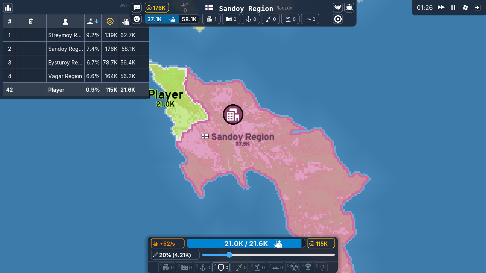
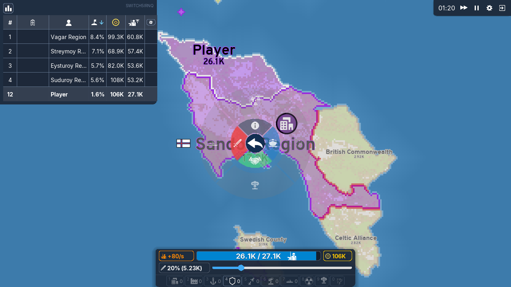
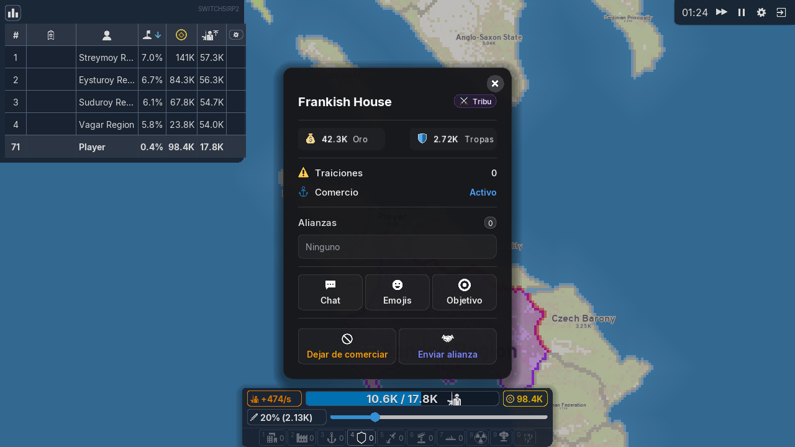
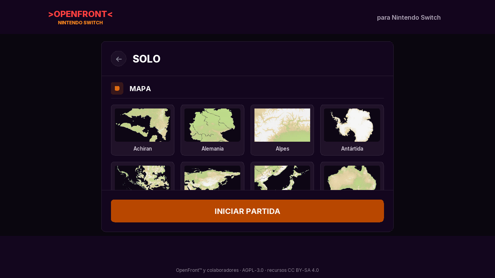

# OpenFront para Nintendo Switch

Port homebrew no oficial de [OpenFront](https://github.com/openfrontio/OpenFrontIO),
el juego de estrategia territorial en tiempo real, para Nintendo Switch.

No es una versión web empaquetada: el **motor real de OpenFront** (la simulación
determinista en TypeScript, sin cambios) se ejecuta dentro de
[QuickJS-ng](https://github.com/quickjs-ng/quickjs) en una aplicación nativa
hecha con libnx y SDL2. La **interfaz es una copia de la de PC**, con sus
medidas, colores, fuentes e iconos originales, adaptada a la pantalla táctil y
al mando.



| Menú radial (ataque, bombas) | Panel de jugador | Partida en solitario |
| --- | --- | --- |
|  |  |  |

## Qué incluye

- Partidas para un jugador contra **naciones** (IA) y **tribus** (bots), con
  la misma lógica de juego que openfront.io.
- **Pantalla de inicio** como la página principal de la web (fondo del mapa,
  nombre editable, Solo, Audio, Controles) y la ventana **Solo** de la web:
  mapa, **dificultad** con sus calaveras, **modo** (todos contra todos o
  equipos, con 2-7 equipos, cuartetos, tríos, dúos o humanos contra
  naciones), tribus, naciones, todas las **opciones** (aparición aleatoria,
  bombas en agua, reloj del juicio final con su ritmo, duración máxima, oro
  inicial, multiplicador de oro, duración de alianzas (0 = sin alianzas),
  tiempo extra, oro y tropas infinitos, construcción instantánea) y
  **desactivar unidades**. En la partida, Menú muestra los modificadores activos como en
  la web.
- **Sonido** de OpenFront: efectos (construir, bombas, alertas, conquistas,
  alianzas, victoria/derrota…), sonido ambiente de las ciudades al acercarte
  y la pestaña **Audio** de la web con sus seis volúmenes. La música es
  opcional (ver *Instalar*).
- **La interfaz del cliente web**, redibujada en nativo con el diseño
  medido del navegador (1280×720) y los recursos de OpenFront (iconos SVG,
  banderas, atlas de unidades, estructuras, estados y emojis, fuentes Inter y
  Overpass):
  - Panel de control: tasa de tropas, barra de tropas, oro, porcentaje de
    ataque con su deslizador y la barra de construcciones con atajos.
  - Clasificación (ordenable, desplazable, con tu fila fijada), reloj,
    velocidad de juego, pausa, menú y salir.
  - **Menú radial** igual que en PC: información, alianza, barco, borrar
    estructura, **construir** (ciudad, puerto, fábrica, puesto de defensa,
    SAM, silo) y **mejorar varias veces de golpe** (×1…×máx), **atacar** con
    bomba atómica, de hidrógeno y MIRV, donar oro/tropas, romper/extender
    alianzas… con sus colores, tiempos de espera y descripciones.
  - Vista previa al construir (fantasma, radio de alcance, coste) y
    **trayectoria de los misiles** con las zonas interceptables por SAM.
  - Tarjeta del jugador al pasar por encima, **panel de jugador** (objetivo,
    embargo, alianzas, trayectoria de cohetes…), enviar oro/tropas, tabla de
    emojis, chat rápido, notificaciones con botones (aceptar/rechazar
    alianzas), ataques en curso con retirada/represalia, pantalla de victoria
    o derrota.
  - Mapa como el renderizador WebGL: relleno de territorio con su
    saturación y transparencia, bordes con tinte de aliados/embargos, cuadros
    de defensa, lluvia radiactiva, estructuras con sus formas e iconos y
    niveles, unidades del atlas coloreadas por jugador, nombres con bandera,
    iconos de estado y emoji, círculos de impacto de las bombas y la vista
    alternativa «terreno/países».
- Los **135 mapas** de OpenFront (en tamaño "compacto") con sus miniaturas.
- Idioma automático según la consola, con las traducciones de OpenFront.
- Controles con **pantalla táctil** y con Joy-Con / Pro Controller (cursor
  virtual), ver abajo.

## Qué no incluye (todavía)

- **Multijugador online.** Necesitaría el protocolo de los servidores de
  OpenFront (con su autenticación y antibots) y que la consola simule a la
  velocidad exacta del servidor.
- Cosméticos/skins, vías de tren dibujadas, repeticiones,
  partidas guardadas y la pantalla completa de ajustes (el botón «Ajustes» del
  menú muestra los controles).

## Estado y rendimiento

Probado: compilación del `.nro` con devkitA64, la versión de escritorio del
mismo código (partidas completas y capturas de cada menú comparadas con el
cliente web) y los 135 mapas. **No se ha probado en una Switch real.**

QuickJS es un intérprete (sin JIT), así que el motor va más lento que en un
navegador: en un Xeon a 2,8 GHz cada tick tarda ~50–65 ms con Britania y
40–100 tribus (el juego web avanza un tick cada 100 ms). La app activa el modo
*boost* de CPU de la Switch (1785 MHz), pero aun así se espera que cada tick
tarde entre 2 y 3 veces más. Cuando la simulación no llega, la partida avanza
más despacio en lugar de dar tirones: el dibujado va en otro hilo. Para que
vaya más fluido: mapas pequeños (Oceanía, Hawái, Islas Feroe, Japón…) y menos
tribus.

## Controles

Pantalla táctil (como el ratón en PC):

| Gesto | Acción |
| --- | --- |
| Tocar | Clic: elegir inicio, atacar, colocar construcción, botones |
| Mantener pulsado | Menú radial (clic derecho) |
| Arrastrar | Mover el mapa · mover los deslizadores |
| Pellizcar | Zoom |

Mando (el stick izquierdo mueve un cursor, como un ratón):

| Botón | Acción |
| --- | --- |
| Stick izquierdo | Mover el cursor |
| A | Clic |
| X | Menú radial en el cursor |
| Y | Ataque en barco hacia el cursor |
| B | Atrás / cancelar (menús, construcción, buques seleccionados) |
| L / R | Porcentaje de ataque −10 % / +10 % |
| ZL / ZR | Alejar / acercar |
| Stick derecho | Mover el mapa · pulsarlo: ir a tu territorio |
| Cruceta ← / → | Elegir construcción o bomba en la barra |
| Cruceta ↑ / ↓ | Mostrar clasificación / tabla de emojis |
| + / − | Menú / pausa |

Para mover buques de guerra: toca el agua junto a ellos (quedan rodeados por
un círculo) y luego toca el destino.

## Instalar

Necesitas una Switch con firmware personalizado (Atmosphère) y el Homebrew
Menu.

1. Descarga el `.zip` de la versión que quieras en la pestaña *Releases*
   del repositorio (cada versión está en `CHANGELOG.md`), o compílalo.
2. Copia su carpeta `switch` a la raíz de la microSD (queda
   `/switch/openfront.nro`; los mapas y demás datos van dentro).
3. Abre el Homebrew Menu **manteniendo R al abrir un juego** (*title
   override*). Desde el álbum (modo applet) la app tiene mucha menos memoria
   y los mapas grandes pueden fallar.

**Música (opcional).** La música de OpenFront no es libre (está en su
carpeta `proprietary/`, «todos los derechos reservados»), así que no va en el
`.nro`. Si la tienes, copia sus mp3 de `proprietary/sounds/music/` a
`/switch/openfront/music/` en la microSD con estos nombres: `menu-theme.mp3`
(menús), `gameplay.mp3`, `gameplay-2.mp3` y `gameplay-3.mp3` (partida). Los
ajustes (nombre y volúmenes) se guardan en
`/switch/openfront/openfront-settings.ini`.

## Compilar

Requisitos: Git, Node.js 24 y Docker (o devkitPro instalado con
`switch-sdl2`, `switch-sdl2_ttf`, `switch-sdl2_image` y `switch-zlib`).

```sh
cd openfront-switch
./scripts/fetch-deps.sh      # OpenFront (commit fijado), QuickJS-ng, cJSON, fuentes
./scripts/build-romfs.sh     # engine.js + mapas + idiomas + iconos + fuentes -> romfs/
./scripts/build-switch.sh    # openfront.nro con la imagen devkitpro/devkita64
```

`build-romfs.sh africa britannia` incluye solo esos mapas (para pruebas).
`./scripts/package.sh` deja el zip para la microSD en `dist/`.

### Versiones

La versión está en `VERSION`. Para publicar una: actualizar `VERSION` y
`CHANGELOG.md`, hacer commit y subir la etiqueta `vX.Y.Z`; el workflow
**OpenFront Switch release** compila y crea la *release* con el zip.

### Versión de escritorio (para desarrollar)

El mismo código compila para Linux/macOS con SDL2, SDL2_ttf, SDL2_image y
zlib:

```sh
cmake -B build/desktop && cmake --build build/desktop
./build/desktop/openfront --romfs romfs/
```

Ratón y teclado como en PC (clic izquierdo, clic derecho = menú radial,
arrastrar, rueda, teclas 1–0 para la barra de construcción); un mando de PC
funciona como el de la Switch. `OPENFRONT_LANG=es` fuerza el idioma.

Prueba automática sin ventana (usada para las capturas): juega sola y, antes
de la captura, abre la escena pedida (`radial`, `build`, `attack`, `hover`,
`panel`, `self`, `send`, `emoji`, `chat`, `settings`, `exit`, `ghost`, `help`,
`menu`):

```sh
SDL_VIDEODRIVER=dummy ./build/desktop/openfront --romfs romfs/ \
  --autoplay faroeislands --frames 1500 --scene radial --screenshot radial.bmp
```

Y para probar solo el motor con Node:
`node scripts/node-host.mjs romfs/engine.js romfs britannia 600`.

## Cómo funciona

```
┌──────────── hilo principal ────────────┐   ┌──────────── hilo del motor ───────────┐
│ SDL2: mapa, unidades, nombres, HUD,    │   │ QuickJS-ng                            │
│ menús · entrada (libnx pad + táctil)   │──▶│  engine.js = motor de OpenFront       │
│                                        │cmd│            + js/adapter.ts            │
│ lee el estado de las casillas          │◀──│ 1 tick cada 100 ms / velocidad        │
│ directamente de los arrays del motor   │snap│ (o lo que tarde, si va lento)         │
└────────────────────────────────────────┘   └───────────────────────────────────────┘
```

- `js/` sustituye al Web Worker, al servidor local y a los controladores
  de la interfaz del cliente web: `adapter.ts` crea la partida
  (`createGameRunner`) y mete los *intents* del jugador en cada turno;
  `hud.ts`, `radial.ts`, `panel.ts`, `build.ts` y `events.ts` son ports de
  `ControlPanel`, `UnitDisplay`, la clasificación, `RadialMenuElements`,
  `PlayerInfoOverlay`, `PlayerPanel`, `BuildPreviewController` y
  `EventsDisplay`, con la misma lógica (qué se puede construir, mejorar o
  lanzar, costes, enfriamientos, textos). Se empaquetan con esbuild junto al
  motor en `romfs/engine.js` y hablan con C por JSON.
- `src/engine.c` ejecuta QuickJS en su propio hilo y responde a las llamadas
  del hilo de dibujado.
- `src/gfx.c` y `src/ui.c`: formas con esquinas redondeadas, iconos,
  banderas, emojis y texto (Inter, DejaVu Sans Mono, Overpass) en
  coordenadas de una página de 1280×720 escalada a la pantalla, y botones con
  el orden de superposición del DOM.
- `src/map.c`: el mapa según los *shaders* del cliente (`TerritoryPass`,
  `BorderStampPass`, `StructurePass`, `UnitPass`, `NamePass`…), con los
  valores de `render-settings.json`.
- `src/hud.c`, `src/radial.c`, `src/menus.c`, `src/solo.c`: los elementos
  de la interfaz web, con las medidas tomadas del cliente real en un
  navegador.
- `scripts/prepare-assets.mjs` rasteriza los iconos y banderas SVG de
  OpenFront, copia sus atlas y convierte las miniaturas de los mapas.

La versión de OpenFront está fijada en `scripts/fetch-deps.sh`. Al
actualizarla, hay que revisar el adaptador: usa piezas internas del motor
(`GameRunner`, los arrays de `GameMapImpl`).

## Licencia y créditos

- Código: **AGPL-3.0** (ver `LICENSE`), como OpenFront, del que deriva.
- OpenFront © OpenFront Inc. y colaboradores —
  <https://github.com/openfrontio/OpenFrontIO>. Mapas, miniaturas,
  traducciones, iconos, banderas, atlas, efectos de sonido, sonido ambiente,
  la imagen de fondo de la portada y la fuente Overpass provienen de su
  carpeta `resources/` (CC BY-SA 4.0, atribución «OpenFront»). No se usa nada de su carpeta `proprietary/`.
- QuickJS-ng (MIT), cJSON (MIT), SDL2, SDL2_ttf, SDL2_image y SDL2_mixer
  (zlib), mpg123 (LGPL-2.1, decodifica los mp3), libnx
  (ISC), Inter (OFL), DejaVu Sans Mono (licencia de Bitstream Vera), y unos
  pocos emojis de Noto Color Emoji (OFL) en `assets/ui-emoji.png`.

Este port no está afiliado ni respaldado por OpenFront Inc. ni por Nintendo.
